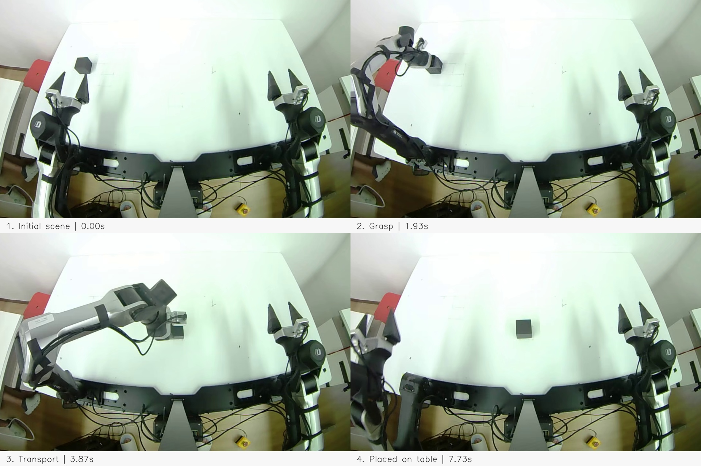
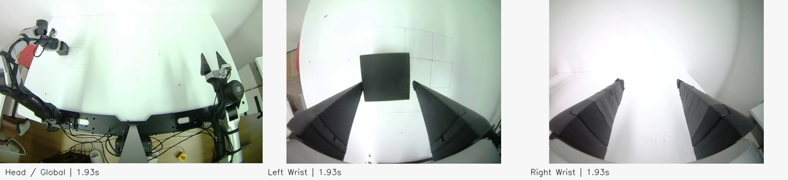

<!-- This file is part of G05_A1Z, licensed under the Galaxea Dynamics A1Z License Agreement.
See LICENSE.txt in the project root; upstream components retain their applicable licenses. -->

# G05_A1Z

[中文](README.md) | **English**

**The original A1Z integration materials in this repository are licensed under the [Galaxea Dynamics A1Z LICENSE AGREEMENT](LICENSE.txt). G0.5 and third-party components retain their applicable licenses.**

Built with Galaxea Dynamics A1Z

A1Z data collection → LeRobot v2.1 conversion → LoRA / full fine-tuning → inference with direct PC control.

Choose `single` (one arm, two cameras) or `dual` (two arms, three cameras). Run the following commands in a **Linux Bash terminal**, from the repository root. In each new terminal, enter the repository and activate the required environment. Initial installation and downloads require internet access. Supply your own device paths, dataset paths, and task descriptions.

## 1. System requirements and cloning

Recommended baseline: **Ubuntu 22.04.5 LTS, Linux 6.8 HWE, x86_64**, with SocketCAN and USB/V4L2 devices. Ubuntu 22.04.5 uses the official 6.8 HWE kernel; see [Ubuntu kernel lifecycle](https://ubuntu.com/kernel/lifecycle). Validate other systems and kernels yourself; version numbers alone do not establish device compatibility.

| Use | Preparation |
| --- | --- |
| Inference / LoRA | NVIDIA GPU; at least 24 GB VRAM recommended; 32 GB host RAM recommended for LoRA |
| Full fine-tuning | At least 80 GB VRAM and 64 GB host RAM recommended |
| Model environment | Python ≥3.10.16 and <3.11; pinned PyTorch 2.7.1 / cu128; compatible GPU driver and CUDA build toolchain |
| Collection / control / conversion | Python 3.11 in separate environments |

These are preparation guidelines. Measure peak usage with a short training, checkpoint save, and reload. Allow disk space for raw data, converted datasets, base weights, and multiple checkpoints. Stop training before running inference on the same GPU.

```bash
sudo apt-get update
sudo apt-get install -y git curl python3-venv build-essential ffmpeg tmux rsync can-utils iproute2 nano
uname -r
nvidia-smi
nvcc --version   # Model dependencies include CUDA extensions; prepare a compatible CUDA toolchain first
df -h .
git clone --branch main https://github.com/userguide-galaxea/a1z-g05-deploy.git G05_A1Z
cd G05_A1Z
python3 scripts/bootstrap.py
python3 scripts/verify_workspace.py
```

Bootstrap initializes the versions pinned in `versions.json` and applies patches. The Leader and SDK use data-collect’s nested sources at `a1z-data-collect/a1z-t/GALAXEA-A1Z`, with versions pinned by that manifest. Missing-model notices are expected before downloading weights. Do not independently update submodules.

## 2. Install environments

Install Miniforge if Conda is unavailable; skip this installation block if you already have Conda:

```bash
curl -fsSL "https://github.com/conda-forge/miniforge/releases/latest/download/Miniforge3-Linux-$(uname -m).sh" -o /tmp/Miniforge3.sh
bash /tmp/Miniforge3.sh -b -p "$HOME/miniforge3"
source "$HOME/miniforge3/etc/profile.d/conda.sh"
conda init bash
```

**Device environment**: shared by collection, camera preview, and the hardware client.

```bash
source "$(conda info --base)/etc/profile.d/conda.sh"
conda create -n g05-robot python=3.11 pip -y
conda activate g05-robot
export A1Z_PYTHON="$CONDA_PREFIX/bin/python"
bash scripts/setup_robot.sh
```

**Model environment**: shared by training and the model server.

```bash
conda create -n g05-model python=3.10 pip -y
conda activate g05-model
python -m pip install uv==0.12.5
export G05_PYTHON="$CONDA_PREFIX/bin/python"
REQ_FILE="$(mktemp)"
(cd GalaxeaVLA && uv export --frozen --python "$G05_PYTHON" --index-strategy unsafe-best-match --format requirements.txt --no-hashes --no-dev --output-file "$REQ_FILE" && uv pip install --python "$G05_PYTHON" --index-strategy unsafe-best-match -r "$REQ_FILE")
rm -f "$REQ_FILE"
python --version
python -c 'import torch; assert torch.cuda.is_available(); print(torch.__version__, torch.version.cuda, torch.cuda.get_device_name(0))'
```

If `nvcc` is missing, install a CUDA Toolkit compatible with the pinned cu128 dependencies before installing model dependencies. For CUDA extension build errors, check `nvcc --version` and the driver/toolchain, then follow the [upstream model environment guide](https://github.com/OpenGalaxea/GalaxeaVLA/blob/89f2322b4ad016e192437adc1a2c253b05bab246/README_zh.md) (Chinese) before continuing.

**Conversion environment**: pin LeRobot to 0.3.3, which writes the v2.1 data format. Keep this environment separate from the model environment.

```bash
conda create -n g05-convert python=3.11 pip -y
conda activate g05-convert
python -m pip install torch==2.7.1 torchvision==0.22.1 --index-url https://download.pytorch.org/whl/cpu
python -m pip install -r requirements-convert.txt
python -c 'from importlib.metadata import version; import av,cv2,h5py; assert version("lerobot")=="0.3.3"; print(av.codec.Codec("h264","w").name)'
```

## 3. Download model assets

First obtain access with your Hugging Face account on the [G0.5 model page](https://huggingface.co/OpenGalaxea/G05) and complete the model terms shown there. Then sign in with the same account to download:

```bash
conda activate g05-model
export G05_PYTHON="$CONDA_PREFIX/bin/python"
hf auth login
python - <<'PY'
from huggingface_hub import snapshot_download
snapshot_download(repo_id="OpenGalaxea/G05", local_dir="checkpoints",
    allow_patterns=["g05-base/**", "action_tokenizer.pt", "qwen3_5_2b_base_processor/**"])
PY
python3 scripts/verify_workspace.py --require-model-assets
```

Check for `checkpoints/g05-base/.hydra/config.yaml`, the base checkpoint, `dataset_stats.json`, `action_tokenizer.pt`, and the processor directory. Continue only after verification passes.

## 4. Collection, preview, and conversion

**data-collect / a1z-t is one optional collection method.** You may use your own collection software or existing data. Regardless of the original source or file format, **training requires LeRobot v2.1**.

| Data source | Next step |
| --- | --- |
| Collected with this project | Follow 4.1–4.4 to preview, collect, inspect, and convert |
| Existing LeRobot v2.1 dataset | Validate with `scripts/check_v21_dataset.py`, then proceed to section 5 |
| Custom HDF5, CSV, MCAP, videos, or other dataset versions | Follow [custom data integration](docs/custom_data_to_v21.md) (Chinese) to implement an adapter, convert to v2.1, and validate before training |

Map joint states and actions, timestamps, cameras, and task text correctly. Use radians for joints and `[0,1]` for grippers. Renaming extensions or changing a version label does not convert a dataset.

### 4.1 Configure devices and preview cameras

Choose your own camera models. The current collection and inference interfaces read Linux V4L2/OpenCV RGB images. Use cameras that reliably provide the required resolution and frame rate: two streams for `single`, three for `dual`. Template values are examples; enter actual device paths and resolutions, and test simultaneous capture. Other camera interfaces require adaptation.

Adjust exposure, gain, and white balance using the vendor tools or V4L2 controls supported by each camera. Keep the target clear, without overexposure or obvious motion blur. This project does not prescribe exposure values or guarantee persistence after reconnection. Preview again after reconnecting or restarting, and keep camera placement, image appearance, and lighting consistent between collection and inference.

**Scene setup:** these are general recommendations, independent of camera or light brand. The screenshots do not establish the actual light positions.

| Item | Placement and checks |
| --- | --- |
| Third-person / global camera | Fix it above the front of the table or at an overhead oblique angle, covering the grasp area, placement area and motion path. Frame mainly the work surface, with less wall or clutter. This is the `head` view, not an additional model input. |
| Wrist cameras | Aim at the gripper contact area. Keep the object visible during approach, grasp, lift and release; avoid finger occlusion or objects leaving the frame. Verify left/right roles for dual arms. |
| Lighting | Use stable, diffuse light from above and in front at an angle. Reduce arm shadows, glare and backlighting; record motion to check flicker, banding and blur, then adjust light placement using the preview. |
| Table and background | Use a matte, simple surface that contrasts with the object; a light mat works for a black cube. Keep the target area clear and fixed. Keep people, screens and unrelated objects out of view where possible. |
| Settings and reproducibility | Set exposure, gain and white balance for visible object detail; lock verified settings when supported. Keep a setup photo and notes on camera placement, resolution/FPS and target area, and reproduce them for inference. |
| Mounting and communication | Secure mounts and leave cable slack for motion. Bind views using stable device paths, and use the commands below to read all two/three cameras together for at least 30 seconds without disconnects. |

Validate a fixed scene first, then expand variations such as object position with corresponding demonstrations. Use the preview to confirm that the object, gripper and target remain visible throughout the task; see [LeRobot data collection tips](https://huggingface.co/docs/lerobot/il_robots#tips-for-gathering-data).

```bash
conda activate g05-robot
export A1Z_PYTHON="$CONDA_PREFIX/bin/python"
export ARM_MODE=single   # Use dual for two arms
mkdir -p "$HOME/a1z-local"
cp -n a1z-data-collect/a1z-t/teleop_app/config.yaml "$HOME/a1z-local/a1z-t.yaml"
nano "$HOME/a1z-local/a1z-t.yaml"
cp -n "configs/collect_${ARM_MODE}.example.yaml" "$HOME/a1z-local/collect_${ARM_MODE}.yaml"
nano "$HOME/a1z-local/collect_${ARM_MODE}.yaml"
export G05_COLLECT_CONFIG="$HOME/a1z-local/collect_${ARM_MODE}.yaml"
ip -details link show type can
ls -l /dev/serial/by-id/ /dev/v4l/by-path/
bash scripts/collect.sh "$ARM_MODE" --check
python scripts/preview_cameras.py --config "$G05_COLLECT_CONFIG"
# After closing the preview, optionally check continuous capture without a window:
python scripts/preview_cameras.py --config "$G05_COLLECT_CONFIG" --check-only --duration 30
```

Set a real `task_description`, `hdf5_cfg.task_name`, output directory, episode count (`num_episodes`), Leader serial ports, Follower CAN interfaces, and camera paths. Prefer absolute output paths; relative paths are resolved from `a1z-data-collect/`. The preview shows Head and Wrist for `single`, or Head, Left Wrist, and Right Wrist for `dual`; verify each against its physical placement.

CAN interfaces must be UP, and the user must have access to serial/video devices. For permission errors on Ubuntu, run `sudo usermod -aG dialout,video "$USER"`, log out of the desktop/session, and log in again; use the appropriate udev rules for devices with different permissions. Before first use, follow the [a1z-t guide](https://github.com/userguide-galaxea/a1z-t/blob/93235404adbb5b753da6fd4d62eccc60805cfeaa/README.md) to check firmware, servo IDs, and gripper calibration. a1z-t remains a nested submodule managed by data-collect; dual mode requires two independent serial ports. Copy its `teleop_app/config.yaml` locally, choose `a1z_t_version: EVT` or `PVT` for your hardware, and set `arm_cfg.leader_config_path` in the collection YAML to that absolute path (null uses the upstream default). Close the preview before collection. Use separate configuration files when switching layouts; `cp -n` preserves existing files.

If a CAN interface is not UP, configure it after confirming no application is using it. Repeat for the second interface in dual mode. If an interface is missing, first install the appropriate adapter driver following the [SDK guide](https://github.com/userguide-galaxea/GALAXEA-A1Z/blob/156af498a947a830ca38efff4dd08fd2da96a200/README.md):

```bash
read -r -p 'CAN interface to configure (e.g. can0): ' A1Z_CAN
sudo ip link set "$A1Z_CAN" down
sudo ip link set "$A1Z_CAN" type can bitrate 1000000
sudo ip link set "$A1Z_CAN" up
ip -details link show "$A1Z_CAN"
```

Repeat collection `--check` and camera preview, then continue after both pass.

### 4.2 Collect data

After switching between single and dual, select the matching configuration again instead of retaining the other mode's environment variable:

```bash
export G05_COLLECT_CONFIG="$HOME/a1z-local/collect_${ARM_MODE}.yaml"
bash scripts/collect.sh "$ARM_MODE" --check
bash scripts/collect.sh "$ARM_MODE"
```

Use the pinned data-collect / a1z-t version. **S starts, E saves, R discards and retries, Q exits**. Stopping does not automatically home the arms. Confirm the workspace and emergency stop are ready, then collect and inspect a few episodes before collecting a larger dataset. Check cameras, actions, gripper behavior, and task text. Do not run another teleoperation or inference client at the same time.

### 4.3 Inspect collected data

Save the episode and wait for writing to finish. Inspect a complete episode; this command reads data and exports videos without controlling an arm:

```bash
conda activate g05-robot
read -r -p 'Full path to a saved episode_N.hdf5: ' A1Z_EPISODE
python a1z-data-collect/tools/inspect_episode.py "$A1Z_EPISODE"
```

The terminal reports task text, duration, sample rate, and joint/gripper ranges. It exports one MP4 per camera next to the HDF5 file. Open these videos in a player and check:

- Two streams for `single` or three for `dual`, with correct camera roles and no overexposure, black frames, or obvious stuttering.
- A complete operation, with corresponding arm movement, grasping, and release across views; correct gripper direction.
- A meaningful task description; 7-dimensional states/actions for single or 14-dimensional states/actions for dual; joint angles in radians, grippers in `[0,1]`, and duration/sample rates consistent with the recording.

Inspect an initial sample before collecting at scale. Afterwards, sample episodes from the beginning, middle, and end. This inspection tool supports manual review; `--check-only` in the next section validates structure, timestamps, and images across all inputs. Keep failed or interrupted recordings separate for diagnosis. Apply the same checks to custom formats before conversion.

### 4.4 Convert project HDF5 to LeRobot v2.1

The converter below accepts only the HDF5 schema produced by this project. Other HDF5 files require adaptation even if their extension is identical. After recording is saved, specify the input and a new output directory in the conversion terminal. Match the output FPS to the intended deployment frequency:

```bash
conda activate g05-convert
export ARM_MODE=single   # or dual
read -r -p 'HDF5 input directory: ' HDF5_INPUT
read -r -p 'New v2.1 output directory: ' V21_OUTPUT
SINGLE_ARGS=(); [[ "$ARM_MODE" != single ]] || SINGLE_ARGS=(--single)
python scripts/convert_hdf5_to_v21.py --input "$HDF5_INPUT" --fps 15 --max-age 0.10 "${SINGLE_ARGS[@]}" --check-only
python scripts/convert_hdf5_to_v21.py --input "$HDF5_INPUT" --output "$V21_OUTPUT" --fps 15 --max-age 0.10 "${SINGLE_ARGS[@]}"
python scripts/check_v21_dataset.py "$V21_OUTPUT"
```

The converter checks timestamps and images before writing, then validates videos and metadata. Failed output is marked `INCOMPLETE` and must not be used for training. Existing output directories are not overwritten. `--max-age 0.10` is the alignment time budget at 15 Hz, not permission to discard arbitrary frames. Investigate synchronization reports before changing thresholds; see [conversion details](docs/hdf5_to_v21.md) (Chinese). Training accepts only genuine **LeRobot v2.1**.

### 4.5 Starter demo: Pick Cube

**Goal: pick up a black cube and place it inside a black box.** Start with `single` and head/wrist cameras. Keep the cameras and box fixed, with the cube and box edges clearly visible.

These recorded pick-and-place demonstrations show one arm moving a cube to another tabletop location on a dual-arm setup; no black box is visible. They illustrate collection and camera views, rather than model inference results. The black box in the starter task below defines its target area. Only work-area crops, resizing and captions are used for display; the original data is unchanged.



Synchronized camera views, from left to right: head, left wrist and right wrist:



Set these fields in the local collection YAML created in Section 4.1, keeping the other device settings:

```yaml
task_description: Pick up the black cube and place it inside the black box.
num_episodes: 100
hdf5_cfg:
  dataset_dir: ../data/raw
  task_name: pick_cube
  start_episode: null
```

`100` is an example collection target, not a guaranteed sufficient dataset size. First record 3–5 episodes and inspect both videos, actions and gripper values using Section 4.3. Start each episode from a consistent pose: approach → grasp → lift → move above the box → lower and release → retreat, then press E to save. Vary cube positions across the intended operating area, including clear placement and release demonstrations. Press R to discard and retry failed episodes.

Convert and validate with `ARM_MODE=single` in Section 4.4, select single LoRA or full training in Section 5, monitor loss in Section 6, then load and execute using Sections 7–8. Set the inference JSON `task` to exactly the same text as `task_description` above. Keep camera placement, objects, target box and starting pose consistent.

Evaluate at 10 cube positions within the demonstrated area that were not used during collection. Record grasp success and final placement success separately; count task success only when the cube is fully inside the box and released. Use the same 10 positions to compare checkpoints, alongside validation loss.

**Dual-arm extension:** use `dual` and three cameras, with one cube and box in each of two separate arm work areas. Collect new dual-arm demonstrations and use `Pick up both black cubes and place each one inside its corresponding black box.` for both collection and inference task text. Use a separate data directory and `task_name` such as `pick_cube_dual`, then follow the dual conversion, training and inference flow.

## 5. Training: short test before a full run

### 5.1 Choose the arm layout and training method

Both methods start from the original G0.5 base model downloaded in section 3 and use the same v2.1 data contract. They are independent alternatives; full fine-tuning does not require a preceding LoRA run. The default validation split uses complete episodes and requires at least two valid episodes; use a single episode only to check recording and conversion.

| Choice | LoRA (`lora`) | Full fine-tuning (`full`) |
| --- | --- | --- |
| Purpose | Reduce training VRAM through low-rank adaptation; a starting point for task validation | Update the complete model; higher VRAM and checkpoint storage requirements |
| single entry | `scripts/train_single_lora.sh` | `scripts/train_single_full.sh` |
| dual entry | `scripts/train_lora.sh` | `scripts/train_full.sh` |
| Inference | Load the run's checkpoint and configuration, preserving the LoRA structure | Load the run's checkpoint and configuration |

Create a training session, then run the remaining commands inside it. If it already exists, return with `tmux attach -t a1z-train`:

```bash
tmux new -s a1z-train
```

Inside the session, enter the repository root, activate the model environment, and choose one of the four combinations:

```bash
conda activate g05-model
export G05_PYTHON="$CONDA_PREFIX/bin/python"
export G05_OUTPUT_DIR="$PWD/outputs"
export ARM_MODE=single   # or dual
read -r -p 'Training mode (lora or full): ' TRAIN_MODE
export TRAIN_MODE
read -r -p 'Validated v2.1 dataset directory: ' A1Z_DATASET
export A1Z_DATASET CUDA_VISIBLE_DEVICES=0 NUM_GPUS=1
unset G05_TRAIN_TASK
case "$ARM_MODE:$TRAIN_MODE" in
  single:lora|single:full) TRAIN_SCRIPT="scripts/train_single_${TRAIN_MODE}.sh" ;;
  dual:lora|dual:full) TRAIN_SCRIPT="scripts/train_${TRAIN_MODE}.sh" ;;
  *) echo 'ARM_MODE must be single/dual; TRAIN_MODE must be lora/full'; exit 2 ;;
esac
python scripts/full_preflight.py
python scripts/check_v21_dataset.py "$A1Z_DATASET" --g05-loader
bash "$TRAIN_SCRIPT" --dry-run
```

### 5.2 Run 10 optimizer steps first

Continue in the same session, using the selected method and dataset:

```bash
export EXP_NAME="a1z_${ARM_MODE}_${TRAIN_MODE}_smoke_$(date +%Y%m%d_%H%M%S)"
mkdir -p "logs/$EXP_NAME"
set -o pipefail
bash "$TRAIN_SCRIPT" model.max_steps=10 model.batch_size=1 batch_size_val=1 model.num_workers=0 checkpointing_steps=10 eval_steps=10 data.val_set_proportion=0.1 logger.type=null logger.log_steps=1 2>&1 | tee "logs/$EXP_NAME/train.log"
printf '%s\n' "${PIPESTATUS[0]}" > "logs/$EXP_NAME/exit_code"
```

Require exit code 0, 10 optimizer updates, finite loss, and a successfully saved checkpoint. Load this artifact following section 7, stop that service, and then start formal training. Configuration parsing or GPU allocation alone does not establish success.

### 5.3 Formal training

| Recommended starting point | LoRA | Full fine-tuning |
| --- | --- | --- |
| Optimizer updates | 20000 | 30000 |
| Batch × gradient accumulation (one GPU) | 1 × 8 | 2 × 4 |
| Learning rate | 1e-4 | 4e-5 |
| Rank / alpha | 8 / 16 | LoRA disabled |
| Weights / computation | BF16 base weights, FP32 adapters / BF16 mixed precision | FP32 weights / BF16 mixed precision |
| Warmup / schedule | 200 / cosine | 200 / cosine |
| Save interval / validation split by complete episode | 5000 updates / approximately 10% | Same |

These are explicit overrides for a recommended starting point; they do not change the underlying defaults. Effective batch = batch × accumulation × GPU count. Steps count optimizer updates. Keep effective batch constant when adjusting per-device batch to available VRAM. Select checkpoints using validation loss, action errors, and physical task success, rather than training loss or the final step alone.

After the short test and reload pass, continue in the original session using the variables from 5.1. If you open a new terminal, repeat its environment and selection commands first. `--dry-run` only parses configuration; it does not replace a real short test.

**Choose A or B, then run C.** Keep `ARM_MODE` and `A1Z_DATASET` from 5.1. If you switch methods, first repeat the 10-step test for that method.

**A. LoRA parameters and entry:**

```bash
export TRAIN_MODE=lora
STEPS=20000; BATCH=1; ACCUM=8; LR=1e-4
if [[ "$ARM_MODE" == single ]]; then TRAIN_SCRIPT=scripts/train_single_lora.sh; else TRAIN_SCRIPT=scripts/train_lora.sh; fi
```

**B. Full fine-tuning parameters and entry:**

```bash
export TRAIN_MODE=full
STEPS=30000; BATCH=2; ACCUM=4; LR=4e-5
if [[ "$ARM_MODE" == single ]]; then TRAIN_SCRIPT=scripts/train_single_full.sh; else TRAIN_SCRIPT=scripts/train_full.sh; fi
```

**C. Launch formal training for the selected method (A or B):**

```bash
export EXP_NAME="a1z_${ARM_MODE}_${TRAIN_MODE}_$(date +%Y%m%d_%H%M%S)"
mkdir -p "logs/$EXP_NAME"
set -o pipefail
bash "$TRAIN_SCRIPT" "model.max_steps=$STEPS" "model.batch_size=$BATCH" "model.grad_accumulation_steps=$ACCUM" "model.learning_rate=$LR" model.warmup_steps=200 model.lr_scheduler_type=cosine batch_size_val=1 checkpointing_steps=5000 data.val_set_proportion=0.1 eval_steps=1000 logger.type=wandb logger.mode=offline logger.workspace=null logger.log_steps=10 2>&1 | tee "logs/$EXP_NAME/train.log"
printf '%s\n' "${PIPESTATUS[0]}" > "logs/$EXP_NAME/exit_code"
```

Record the experiment name and `logs/$EXP_NAME/train.log` path. `logs/$EXP_NAME/exit_code` must contain 0 for a normal command exit. Press Ctrl+B, then D to detach while training continues; return with `tmux attach -t a1z-train`.

Outputs are under `outputs/task-directory/experiment-name/` (see the log for the exact path), including `.hydra/config.yaml`, `dataset_stats.json`, `checkpoints/step_N.pt`, and a `last.pt` symlink. Validation uses complete episodes; with too little data, collect more valid episodes before assessing generalization.

## 6. Monitor live loss curves

Open another terminal and specify the training log:

```bash
python3 -m venv .venv-tools
.venv-tools/bin/python -m pip install flask
read -r -p 'Training log path: ' TRAIN_LOG
.venv-tools/bin/python scripts/loss_server.py "$TRAIN_LOG" --host 127.0.0.1 --port 8888
```

Open [http://127.0.0.1:8888](http://127.0.0.1:8888) locally. Loss / GradNorm refresh every 5 seconds; missing metrics are shown without numeric values. For a remote training machine, establish a tunnel from your own computer, then open the same address:

```bash
read -r -p 'Username@training-server: ' TRAIN_SSH
read -r -p 'SSH port: ' TRAIN_SSH_PORT
ssh -N -L 8888:127.0.0.1:8888 -p "${TRAIN_SSH_PORT:-22}" "$TRAIN_SSH"
```

Charts require browser access to the CDN. Offline, inspect JSON at `/data`. The dashboard only reads logs; it does not control training.

## 7. Load a checkpoint and start the model server

**Terminal A: model environment.** Stop training on the same GPU first. Match single-trained models to the single client, and dual-trained models to the dual client. LoRA and full fine-tuning use the same server command; the training configuration restores the appropriate structure.

Select a training artifact from `checkpoints/step_N.pt`; `last.pt` points to the latest saved checkpoint. Use the fine-tuned artifact when evaluating training results. This project's LoRA checkpoint includes base weights and adapters; load it directly without manually merging or separately supplying a PEFT adapter.

```bash
conda activate g05-model
export G05_PYTHON="$CONDA_PREFIX/bin/python"
find outputs -path '*/checkpoints/step_*.pt' -type f
read -r -p 'Full path to the checkpoint to load: ' MODEL_CKPT
export ACTION_STEPS=16 POLICY_HOST=127.0.0.1 POLICY_PORT=8765
export G05_TMUX_SESSION=a1z-policy
bash scripts/server_tmux.sh start "$MODEL_CKPT" model.model_weights_to_bf16=true
bash scripts/server_tmux.sh status
bash scripts/server_tmux.sh tail
```

`running` only confirms that a process exists. Repeat `tail` until `Policy server listening` appears before proceeding to section 8. The server computes actions without controlling hardware, and stays running in tmux after the terminal closes.

When moving a model, preserve the complete run directory: checkpoint, `.hydra/config.yaml`, `dataset_stats.json`, and tokenizer sidecar. The deployment machine also needs the processor/tokenizer assets from section 3. Do not copy only a `.pt` file. For large checkpoints, follow the [deployment guide](docs/deployment_modes.md) (Chinese) to export inference weights.

To switch between LoRA/full models or checkpoints, **stop the client first**, run the following in terminal A, then select a checkpoint and repeat the `start` commands above:

```bash
export G05_TMUX_SESSION=a1z-policy
bash scripts/server_tmux.sh stop
```

Stopping only the model server does not stop a running hardware client for you.

## 8. Device checks and inference execution

**Terminal B: device environment, from the repository root.** Exit collection, preview, and other control programs first, while keeping the model server in terminal A running. Configure devices and test each stage in order:

```bash
conda activate g05-robot
export G05_CLIENT_PYTHON="$CONDA_PREFIX/bin/python"
export ARM_MODE=single   # or dual
mkdir -p "$HOME/a1z-local"
if [[ "$ARM_MODE" == single ]]; then TEMPLATE=pc-single; else TEMPLATE=pc-direct; fi
cp -n "configs/deployment/$TEMPLATE.example.json" "$HOME/a1z-local/client_${ARM_MODE}.json"
nano "$HOME/a1z-local/client_${ARM_MODE}.json"
bash scripts/client.sh --config "$HOME/a1z-local/client_${ARM_MODE}.json" --check
# Cameras only: check against collection; close with Q/Esc before continuing.
python scripts/preview_cameras.py --config "$HOME/a1z-local/client_${ARM_MODE}.json"
bash scripts/client.sh --config "$HOME/a1z-local/client_${ARM_MODE}.json"
# Once the hardware and emergency stop are ready, inspect real observations before executing actions:
bash scripts/client.sh --config "$HOME/a1z-local/client_${ARM_MODE}.json" --observe-only
bash scripts/client.sh --config "$HOME/a1z-local/client_${ARM_MODE}.json" --execute
```

Before inference, preview cameras using this JSON. Check mounting positions, orientations, head/wrist roles, resolution, and exposure against collection. Correct differences before executing model actions. Preview opens cameras only, without CAN or Leader connections; close it before starting the client.

Set CAN interfaces, camera paths, the collection task and camera mapping in JSON. `image_size` is the actual `[width,height]`; adjust the dual template to the recording resolution. `control_frequency` must match the v2.1 dataset FPS. For server and client on the same PC, use `127.0.0.1:8765`, matching terminal A. `ACTION_STEPS=16` is the action execution window after each model prediction, not 16 Hz.

`single` uses `can_channel`, `camera_head`, and `camera_wrist`, independent of the physical mounting side. Internal model fields remain compatible; do not manually rename weight or dataset fields. `--check` validates configuration only. The default mode uses synthetic observations and does not open devices. `--observe-only` starts the SDK and reads real devices, without sending model actions.

| Parameter | Template value and meaning |
| --- | --- |
| `max_initial_joint_step` / `max_joint_step` | Both 0.1 rad; limit the first target relative to feedback and subsequent consecutive policy targets respectively; violations identify the joint and values |
| `gripper_boundary_tolerance` | 0.02; clip small boundary overshoots to `[0,1]`, reject larger or non-finite values; not a unit converter |
| `max_cycles` | 3 actions; after a supervised short test, set 0 for continuous execution; this is not a task repetition count |
| `smoothing.enabled` | false by default; set true for direct smoothing to 250 Hz while retaining velocity, acceleration, and action limits |
| `smoothing.stale_timeout` | 1 second; stale actions trigger hold; inspect observation, transport, and inference latency rather than increasing the timeout to hide disconnections |

After the short test, edit the matching JSON: set `max_cycles=0` for continuous execution and `smoothing.enabled=true` for smoothing, then repeat `--execute`. Stop the old client before changing the mode or model. Restart the client after configuration changes.

Ctrl+C stops the client without automatic homing; for dual arms, check both stop results. Hold may retain torque, and disabling a motor does not disconnect physical power. For camera `No such device` errors, check USB disconnections, power, bandwidth, and power-saving settings; reopen the client after reconnection. See [deployment details](docs/deployment_modes.md) (Chinese) for parameters and troubleshooting.
